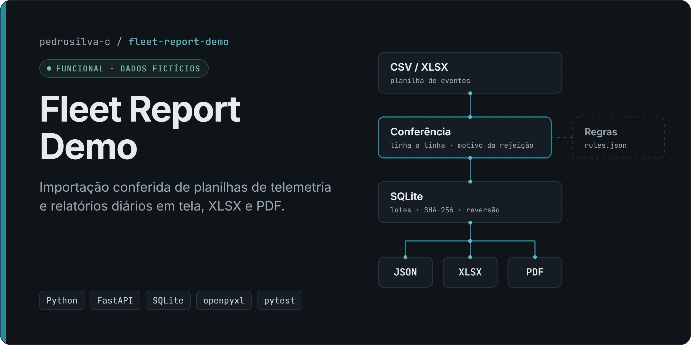
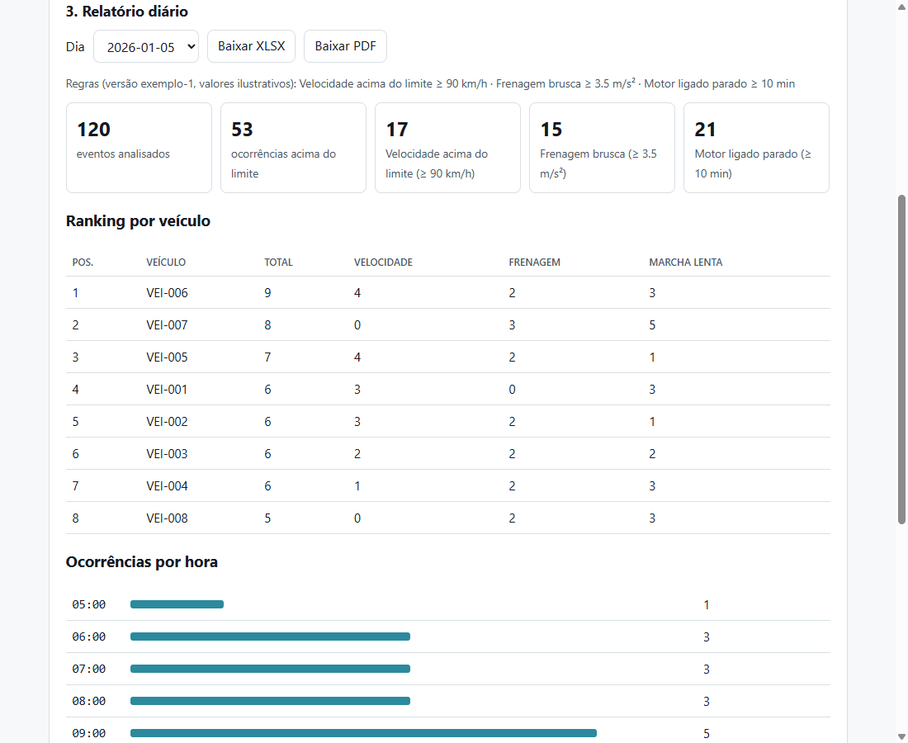

# Fleet Report Demo

> **Demonstração independente com dados 100% fictícios.** Foi escrita do zero como projeto de portfólio, inspirada num tipo de problema que conheci no trabalho. **Não contém código, regras, dados, documentos nem nomes de nenhuma empresa**, e os limites das regras são ilustrativos.

Aplicação local que **importa planilhas de eventos de telemetria de frota, confere cada linha e gera relatórios diários** em tela, XLSX e PDF.

**[Portfólio](https://pedrosilva-c.github.io/portfolio/)** · **[Perfil no GitHub](https://github.com/pedrosilva-c)**

## Problema

Relatórios operacionais montados à mão a partir de planilhas exportadas costumam ter três falhas:

1. Linhas com erro entram sem que ninguém perceba.
2. O mesmo arquivo é contado duas vezes.
3. Um dia sem arquivo aparece como "zero ocorrências".

Esta demo trata exatamente esses três pontos.

## Funcionalidades

- Importação de **CSV** (separador `;` ou `,`, vírgula decimal) e **XLSX**, com conferência linha a linha e o motivo de cada rejeição.
- Recusa do mesmo arquivo (SHA-256) e de eventos já importados por outro arquivo.
- Reversão de lotes, mantendo o registro com status `revertido`.
- Relatório diário em tela, **XLSX** (3 abas) e **PDF**: resumo, ocorrências por tipo e por hora, ranking por veículo.
- Dias sem importação aparecem como *cobertura ausente*, nunca como zero.
- Regras com limites configuráveis em JSON e versão exibida no relatório.
- Gerador de planilhas fictícias com semente fixa e 5 linhas inválidas de propósito.

## Tecnologias

Python · FastAPI · SQLite · openpyxl · fpdf2 · pytest · HTML/CSS/JavaScript

## Demonstração

Relatório diário gerado a partir da amostra fictícia:



## Decisões de projeto

- **Nada é corrigido silenciosamente.** Cada linha é aceita ou rejeitada com um motivo legível: data inválida, veículo ausente, tipo desconhecido, valor não numérico ou duplicata.
- **Idempotência.** O mesmo arquivo (mesmo SHA-256) é recusado na segunda importação, e um evento idêntico vindo de outro arquivo é rejeitado como "já importado".
- **Reversão auditável.** Um lote pode ser revertido: os eventos saem, mas o registro do lote fica com o status `revertido`.
- **Ausência ≠ zero.** Um dia sem importação aparece como *cobertura ausente*, nunca como "0 ocorrências".
- **Regras fora do código.** Os limites ficam em [`config/rules.example.json`](config/rules.example.json), com versão exibida nos relatórios.
- **Dados de exemplo reproduzíveis.** O gerador usa semente fixa e insere 5 linhas inválidas de propósito, para demonstrar a conferência.

## Arquitetura

```
 CSV / XLSX ──▶ importer.py ──▶ storage.py (SQLite) ──▶ reports.py ──▶ JSON · XLSX · PDF
               conferência     lotes, eventos,          resumo, por tipo,
               linha a linha   SHA-256, reversão        por hora, ranking
                    ▲                                        ▲
                 rules.py  ◀── config/rules.example.json ────┘
                                                              
 api.py (FastAPI) expõe tudo em /api/* e serve web/ (HTML + JS sem build)
```

| Endpoint | Função |
|---|---|
| `POST /api/imports` | Envia CSV/XLSX (até 5 MB) e devolve linhas aceitas e rejeitadas com o motivo |
| `GET /api/imports` · `POST /api/imports/{id}/revert` | Lista e reverte lotes |
| `GET /api/days` | Dias com dados |
| `GET /api/reports/daily/{dia}` · `.xlsx` · `.pdf` | Relatório do dia em JSON, planilha ou PDF |
| `GET /api/rules` | Regras em vigor |

A documentação interativa da API fica em `http://127.0.0.1:8000/docs` (gerada pelo FastAPI).

## Como executar

Requisitos: Python 3.11+.

```powershell
git clone https://github.com/pedrosilva-c/fleet-report-demo.git
cd fleet-report-demo
py -m venv .venv
.\.venv\Scripts\python.exe -m pip install -r requirements.txt

# 1) gerar uma planilha fictícia (2 dias, 240 eventos + 5 linhas inválidas)
.\.venv\Scripts\python.exe -m fleetdemo.generate --dias 2 --saida amostras

# 2) subir a aplicação local
.\.venv\Scripts\python.exe -m uvicorn fleetdemo.api:create_app --factory --host 127.0.0.1 --port 8000
# abra http://127.0.0.1:8000 e importe o arquivo de amostras/
```

Variáveis opcionais: `FLEETDEMO_DB` (caminho do banco SQLite, padrão `fleetdemo.db`) e `FLEETDEMO_RULES` (arquivo de regras).

## Testes

```powershell
.\.venv\Scripts\python.exe -m pytest
```

**20 testes OK (11/11/2026).** Eles cobrem:

- determinismo do gerador e uso só de identificadores fictícios;
- limite inclusivo e validação do arquivo de regras;
- rejeição de cada tipo de linha inválida, CSV com `;` ou `,` e vírgula decimal, XLSX, colunas ausentes e formato não suportado;
- arquivo repetido, arquivos sobrepostos, reversão idempotente;
- contagem do relatório e "sem dados" ≠ zero;
- segurança: injeção de fórmula neutralizada no XLSX, escrita entre origens bloqueada (403) e cabeçalho `Host` desconhecido recusado (400);
- API de ponta a ponta: importação, 409 no arquivo repetido, relatório JSON, XLSX com 3 abas, PDF válido, 422 em dia inválido, reversão, 404 em lote inexistente, 413 para arquivo acima do limite.

A interface web também foi testada manualmente no Chromium: importação da amostra (240 aceitas e 5 rejeitadas com os motivos), relatório, downloads e nenhum erro no console.

## Limitações e status

**Status atual: funcional como demonstração local.** Dados 100% fictícios.

- Demonstração local, **sem autenticação**: não exponha na rede. Como proteção mínima, só aceita `Host` 127.0.0.1/localhost (contra DNS rebinding), recusa requisições de escrita vindas de outra origem (contra CSRF) e prefixa com apóstrofo os textos importados que começam com `= + - @` antes de gravá-los no XLSX (contra injeção de fórmula).
- Sem fuso horário: os horários são tratados como locais.
- Três tipos de evento fixos (`velocidade`, `frenagem`, `marcha_lenta`); só os limites são configuráveis.
- A interface é propositalmente simples (HTML e JavaScript sem framework), para manter a demo sem etapa de build.

## Autor

**Pedro Henrique da Silva Pereira** · [Portfólio](https://pedrosilva-c.github.io/portfolio/) · [LinkedIn](https://www.linkedin.com/in/pedrosilva-sistemas/)
